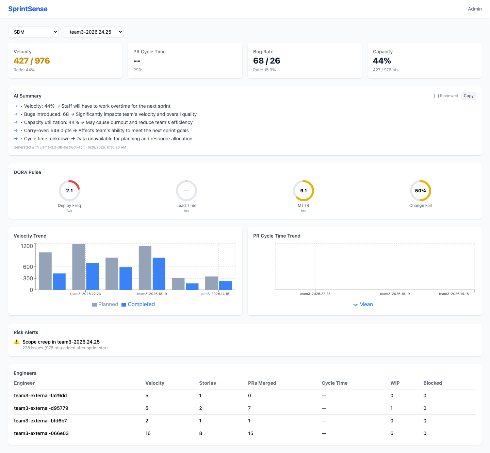
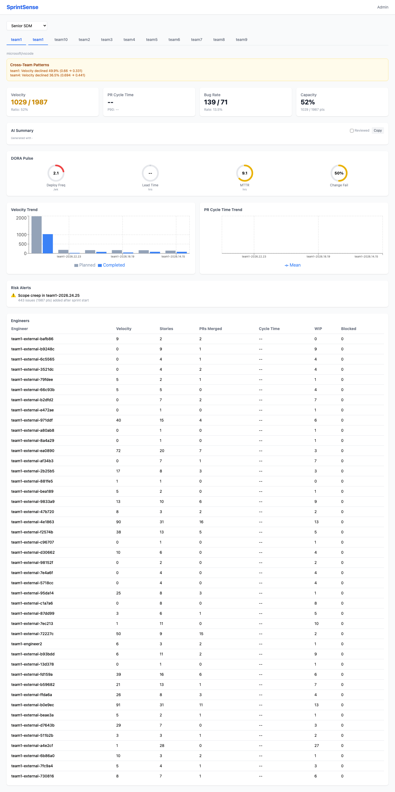
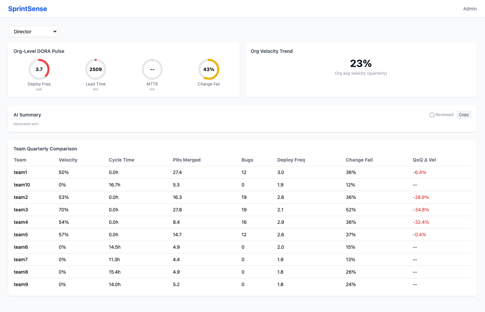
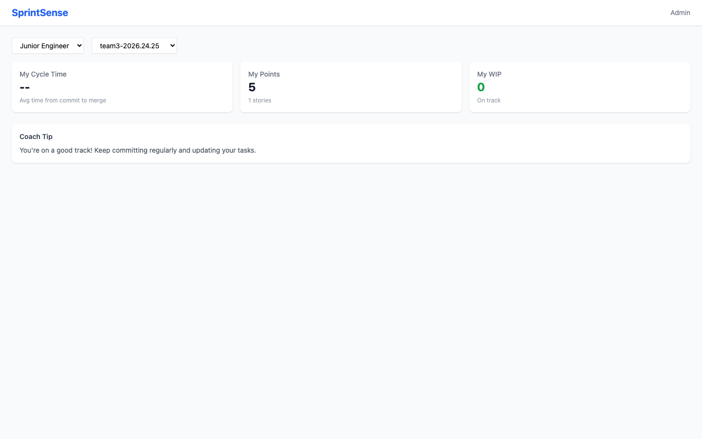
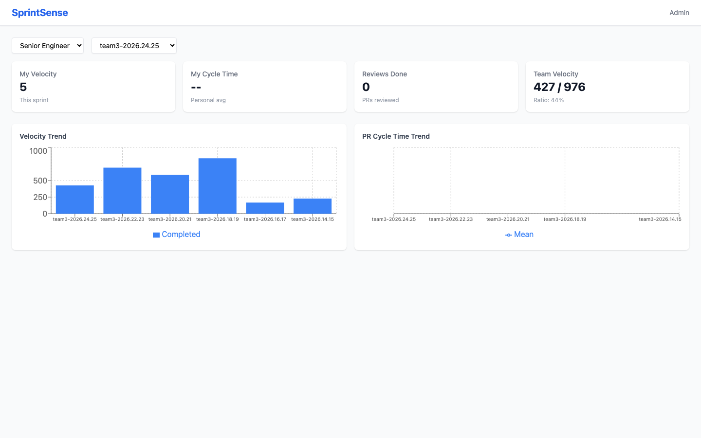
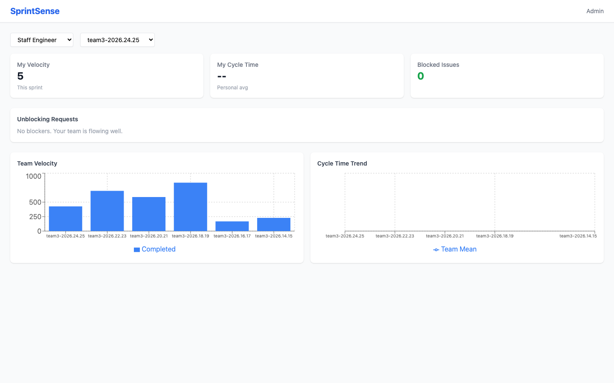
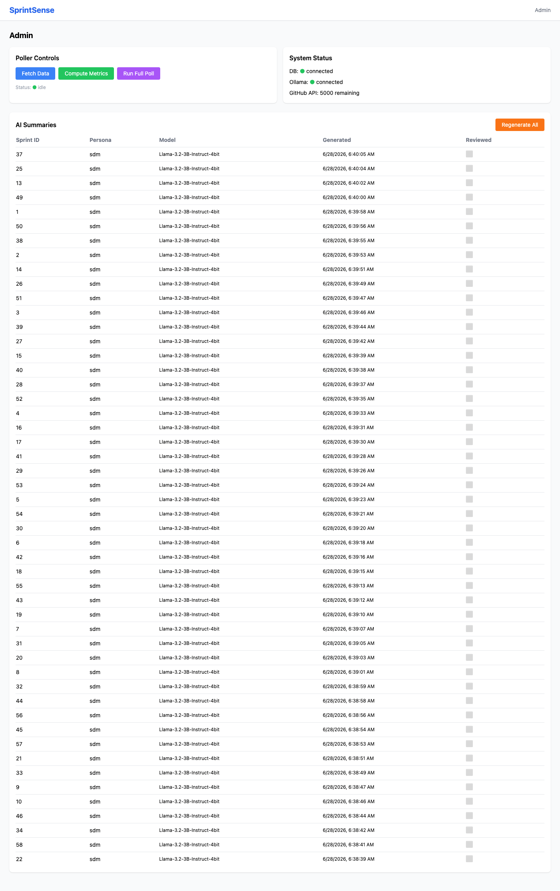

# SprintSense

LLM-powered sprint analytics with DORA metrics — automated sprint health intelligence from GitHub Issues, PRs, and incident data.

## Problem

Sprints are run on gut feel — velocity, capacity, and risk are estimated without data. Reports take hours to compile from Jira, GitHub, and incident trackers. Engineers and EMs can't see real-time sprint health.

## What It Does

SprintSense is an AI sprint coach that turns raw engineering data (GitHub Issues, PRs, Actions, incidents) into actionable insights for every level of the engineering org:

- **Sprint metrics**: velocity ratio, cycle time (mean/median/P90), bug regression rate, capacity utilization
- **DORA metrics**: deployment frequency, lead time, MTTR, change failure rate
- **Engineer metrics**: personal velocity, WIP, blocked issues, review turnaround
- **Risk alerts**: stale PRs, overloaded engineers, scope creep
- **AI summaries**: persona-tuned bullet summaries generated by a local LLM (Llama-3.2-3B-Instruct-4bit via omlx)

## Architecture

```
GitHub API → Poller (Phase 1: Fetch, Phase 2: Compute) → PostgreSQL → Flask API → React Dashboard
                                                              ↑
                                                    omlx (local LLM)
```

Three services in Docker Compose:
- **db** — PostgreSQL 16
- **api** — Flask + Gunicorn (metrics, poller triggers, AI summaries)
- **dashboard** — React + Vite + Recharts (SPA with persona-based views)

## Personas & Views

The dashboard adapts to 6 personas, each showing a different card set:

### SDM (Sprint Delivery Manager)


Full sprint dashboard: velocity, cycle time, bug rate, capacity, DORA pulse gauges, velocity/cycle-time trends, risk alerts, and per-engineer table. Includes AI summary with 5 consequence-first bullets.

### Senior SDM


Multi-team view with per-team tab navigation. Each tab shows the full SDM dashboard for that team's latest sprint. Cross-team pattern detection highlights velocity declines and cycle-time increases. No team ranking — tabs only.

### Director


Org-level aggregate view: org-wide DORA gauges, quarterly velocity, team quarterly comparison table with QoQ deltas, and a strategic AI summary (4 bullets + one recommendation). No per-engineer data — Director sees org trends, not individual performance.

### Junior Engineer


Personal-only view: my cycle time, my points, my WIP, plus a coaching tip. No team-level data visible — prevents surveillance anxiety. Designed for self-improvement, not comparison.

### Senior Engineer


Personal metrics + team aggregate: my velocity, my cycle time, reviews done, team velocity. Includes velocity and cycle-time trend charts. Bridges individual contribution with team context.

### Staff Engineer


Personal metrics + cross-team visibility: my velocity, my cycle time, blocked issues, plus team velocity and cycle-time trends. Focuses on unblocking — surfaces blocked items that need staff-level intervention.

### Admin


System health panel: DB status, LLM connection, GitHub API rate limit, poller status (last fetch/compute). Buttons to trigger fetch, compute, and full poller runs. AI summary management with regenerate and review toggle.

## Tech Stack

- **LLM**: Llama-3.2-3B-Instruct-4bit via omlx (OpenAI-compatible local server)
- **Backend**: Python, Flask, SQLAlchemy, Gunicorn
- **Frontend**: React, Vite, Recharts, Tailwind CSS
- **Database**: PostgreSQL 16
- **Data sources**: GitHub REST API (Issues, PRs, Actions), synthetic incidents
- **Testing**: pytest (82 tests), vitest + @testing-library/react (13 tests)
- **Containerization**: Docker Compose (db, api, dashboard)

## Getting Started

```bash
# Start all services
docker compose up -d --build

# Seed test data (10 teams, 120 sprints, 200+ issues per team)
python3 tools/seed_database.py
python3 -c "from api.app import create_app; ..."  # run compute

# Access
open http://localhost:3000        # dashboard
open http://localhost:3000/admin  # admin panel
```

## Project Structure

```
sprint-intelligence/
├── api/                    # Flask API + poller
│   ├── app.py             # App factory
│   ├── models.py          # SQLAlchemy models
│   ├── routes/            # Dashboard, poller, admin, ask endpoints
│   └── poller/            # Phase 1 (fetch) + Phase 2 (compute)
│       ├── compute.py     # Sprint/engineer/DORA metrics, AI summaries
│       ├── prompts.py     # Per-persona LLM prompt templates
│       ├── ollama_client.py  # omlx client
│       └── fetch.py       # GitHub API fetcher
├── dashboard/             # React SPA
│   └── src/pages/         # Dashboard + Admin pages
├── tools/                 # Seed, transform, screenshot scripts
├── screenshots/           # Evidence screenshots
├── docs/                  # Spec + TODO
└── docker-compose.yml     # db + api + dashboard
```

## Status

- **M1**: Data pipeline + SDM core ✅
- **M2**: AI summaries + alerts + DORA ✅
- **M3**: IC dashboards (Junior/Senior/Staff) ✅
- **M4**: Multi-team + SrSDM + Director (in progress)
- 95 tests passing (82 Python + 13 frontend)
- 10 teams, 120 sprints, 920 engineer metrics, 177 incidents

## License

MIT
